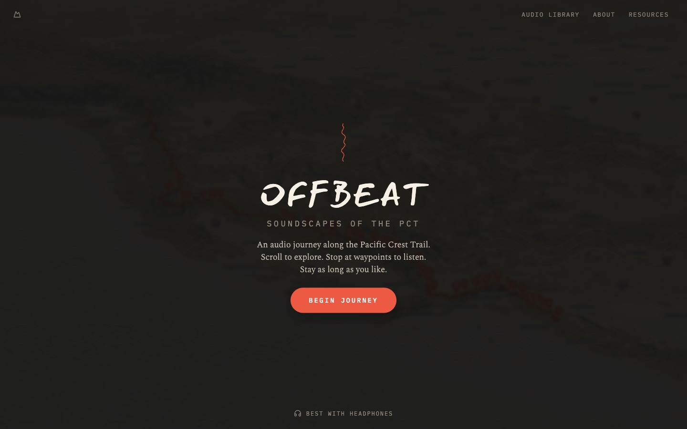
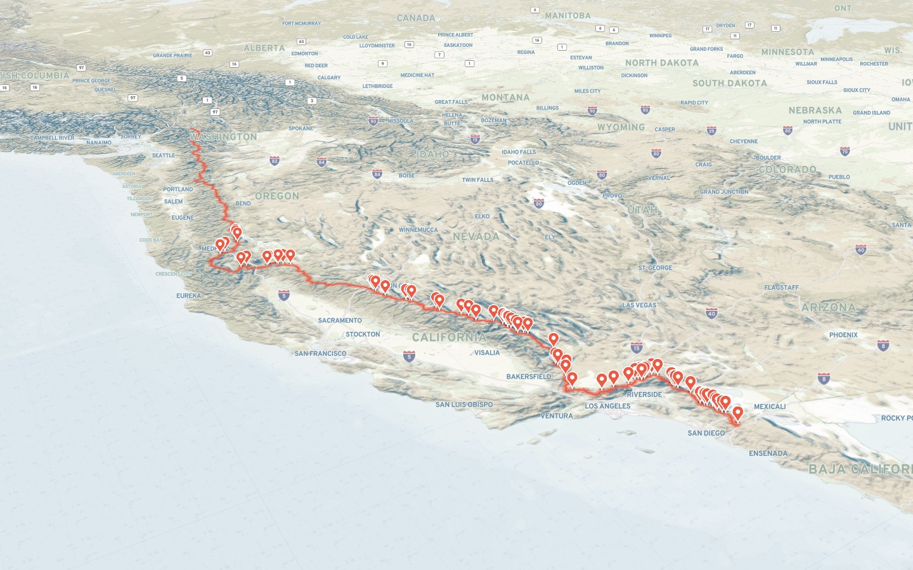
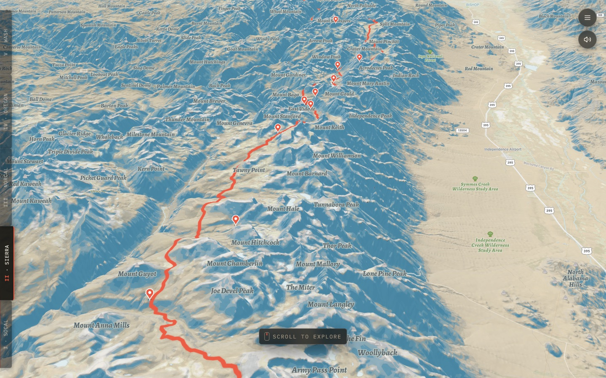
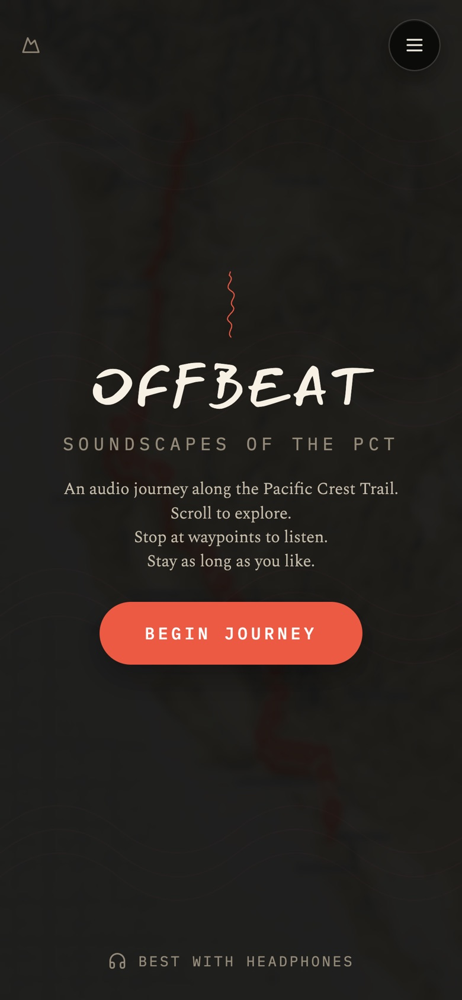
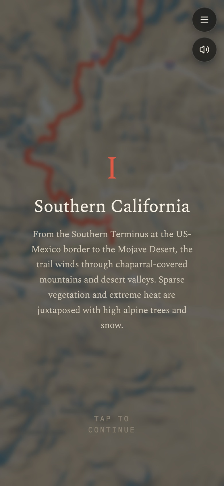
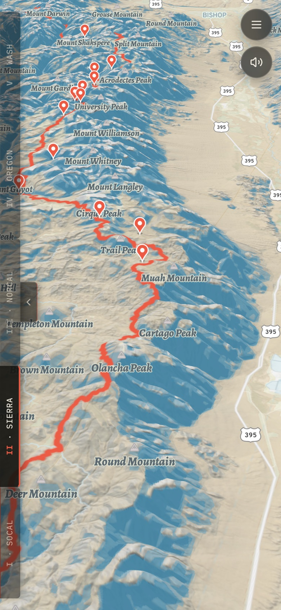
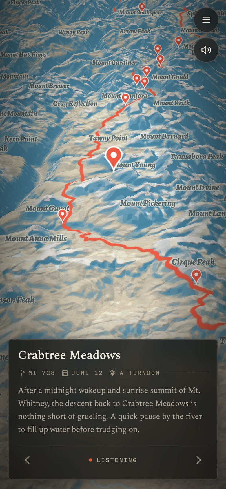
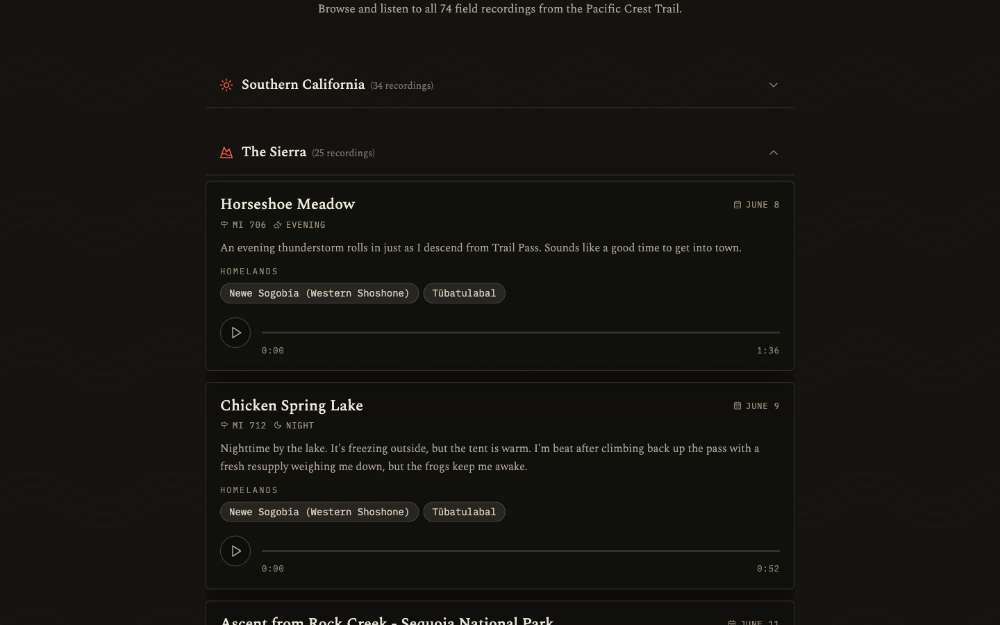
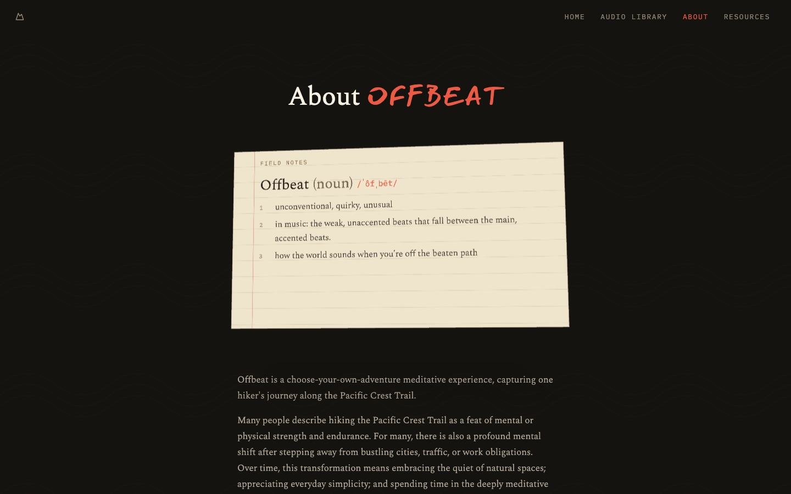

# Offbeat: Soundscapes of the PCT

**Hike the Pacific Crest Trail: a scroll-driven 3D journey over live terrain from Mexico toward Canada, featuring 74 field recordings taken along the way.**

**[Try it live at offbeathike.com →](https://offbeathike.com)**

<table>
  <tr>
    <td width="50%"></td>
    <td width="50%"></td>
  </tr>
</table>

The Pacific Crest Trail runs 2,650 miles from Mexico to Canada. Most people will never hike it: they can't take half a year off, their body won't allow it, or they've been told the outdoors isn't for them. Photos of the trail are everywhere. What it *sounds* like, once the planes and leaf blowers fall away, is almost undocumented.

Offbeat is a 3D flight along the real trail, built from Anna Wozniewicz's field recordings on her thru-hike. You scroll to walk north over live mountain terrain. Pins along the route open a recording made at that exact spot, and it loops for as long as you want to stay.

<h3 align="center">Built with</h3>

<p align="center">
  <a href="https://www.mapbox.com"><picture><source media="(prefers-color-scheme: dark)" srcset="docs/logos/mapbox-white.svg"></picture></a>
  &nbsp;&nbsp;&nbsp;&nbsp;&nbsp;&nbsp;&nbsp;&nbsp;
  <a href="https://native-land.ca"></a>
</p>
<p align="center">3D terrain and maps by <a href="https://www.mapbox.com">Mapbox</a>. Indigenous homelands from <a href="https://native-land.ca">Native Land Digital</a>.</p>

## How to use it

1. **Put on headphones and press Begin Journey.** The camera pulls back to show the whole trail, then drops to the Mexico border.
2. **Scroll or swipe down to hike north.** On a phone, drag down. On a laptop, two-finger swipe down. The further you scroll, the further you walk.
3. **Read the chapter card.** The trail has five chapters: Southern California, the Sierra, Northern California, Oregon, Washington. Each one opens with a card that pauses the walk. Tap to keep going.
4. **Tap a pin to listen.** The camera flies in to the spot and the recording starts. It loops seamlessly, so you can stay as long as you like. The card shows the mile, the date, the time of day and whose homeland you're standing on.
5. **Use the arrows for the next or previous recording**, or tap anywhere off the card to close it and keep walking.

Jump between chapters with the tabs on the left edge. Mute with the speaker button. The **Audio Library** lists every recording by chapter if you'd rather just listen.



<table>
  <tr>
    <td align="center" width="25%"><br /><sub><b>Begin.</b> Best with headphones.</sub></td>
    <td align="center" width="25%"><br /><sub><b>Five chapters.</b> Each one sets the scene.</sub></td>
    <td align="center" width="25%"><br /><sub><b>Swipe to walk.</b> Every swipe covers trail miles.</sub></td>
    <td align="center" width="25%"><br /><sub><b>Stop and listen.</b> Loops until you move on.</sub></td>
  </tr>
</table>

<table>
  <tr>
    <td width="50%"><br /><sub><b>Audio Library.</b> All 74 recordings, grouped by chapter.</sub></td>
    <td width="50%"><br /><sub><b>About.</b> Why the project exists and who made it.</sub></td>
  </tr>
</table>

## Product decisions

**Who it's for.** Someone at a desk or on a phone who wants ten minutes of somewhere else. So there's nothing to learn: scroll to walk, tap to stop, tap away to keep going. The camera does the steering.

**Place over playlist.** Every recording sits at the coordinate where it was made. You don't pick a track. You arrive somewhere and hear it.

**Whose land this is.** Each card names the Indigenous homelands the recording was made on. The 74 recordings sit on 31 of them, and a project about listening to a place should say who it belongs to.

**Seamless loops.** Recordings loop with no audible click or gap, so you can stay at a spot indefinitely.

## How it was built

Started as a [v0](https://v0.app) prototype; about a year and 250+ commits later, a bespoke scroll-driven map.

- **Prototype (Sep–Nov 2025).** Five chapter buttons, each a Mapbox `flyTo`. It felt like a slideshow, not a walk, so the distance in between had to become continuous.
- **Scroll becomes distance (Jan 2026).** Scroll maps to miles along the trail. Raw GPS made the camera twitch on switchbacks, so the line is smoothed before the camera follows it.
- **Mobile and story (Mar 2026).** Splash, mobile chapter cards, About page. DOM map pins jittered, and the intro animation and scroll loop fought over the camera.
- **Camera rewrite (Jul 2026).** Replaced `flyTo` with a hand-written free camera: position, altitude, pitch and heading computed for any mile ([`lib/railing-camera.ts`](lib/railing-camera.ts)). One owner of the camera at a time; pins moved to Mapbox symbol layers, which ended the jitter.
- **No blank terrain (Aug 2026).** Terrain is pre-loaded under the splash screen and ~100 miles ahead as you scroll ([`lib/tile-prefetch.ts`](lib/tile-prefetch.ts)). The camera stops redrawing once it settles, so the map idles. Phones get lighter GPU settings and their own framing.
- **Real recordings (Sep 2026).** A CSV ingest script (`pnpm ingest:audio`) turns a spreadsheet into map pins, looking up each spot's homelands from the Native Land API.
- **Gapless audio (Oct 2026).** `<audio loop>` left a gap at the seam, and Blob's 10 GB/month cap risked taking the site down. Recordings now ship as Opus from the static CDN and loop sample-accurately through Web Audio, with at most three clips in memory. [Plan](docs/plans/2026-10-01-gapless-trail-loops.md).

## Why it matters

Noise pollution is a long-term health risk, and for most city dwellers true quiet is a car ride and a long walk away. Offbeat brings it closer. It's also an archive: climate, funding and policy will change the PCT, and its sound is far less documented than its views.

## Beyond the PCT

The pattern is **geo-pinned media → a camera rail along a route → scroll as the timeline**. It fits any story that happens along a line:

- **Other long trails.** The Appalachian Trail, the Camino, Te Araroa.
- **Rivers and coastlines.** Recordings, interviews or water-quality data along a watershed.
- **Climate change, before and after.** Glacier retreat or wildfire scars along one route.
- **Oral history.** Testimony pinned to the places it describes along a migration route or rail line.

Swap `public/pct-trail.geojson`, the chapters in `data/pct-segments.ts` and the markers in `data/audio-markers.ts`; the flight stays the same.

## Run it

```bash
pnpm install
cp .env.example .env.local   # add MAPBOX_ACCESS_TOKEN
pnpm dev                     # http://localhost:3000
pnpm test
```

Only `MAPBOX_ACCESS_TOKEN` is required. It's read server-side and never exposed as a public env var. `NATIVE_LAND_API_KEY` and `BLOB_READ_WRITE_TOKEN` are only used by `pnpm ingest:audio` when adding recordings.

Built with Next.js 16, React 19, Mapbox GL JS, Turf.js and the Web Audio API. Deployed on Vercel. No database; recordings ship as static files.

## Team

- **Anna Wozniewicz**: field recording and experience design. [LinkedIn](https://www.linkedin.com/in/annawozniewicz)
- **Haiden McGill**: spatial experience and product engineering. [GitHub](https://github.com/heyhaiden) · [LinkedIn](https://www.linkedin.com/in/haidenmcgill)

Say hi: [hello@offbeathike.com](mailto:hello@offbeathike.com)

## License

The code is [MIT licensed](LICENSE).

The field recordings (`public/audio/`), recording descriptions (`content/`, `data/audio-markers.ts`), team photos (`public/team/`) and site writing are © Anna Wozniewicz and Haiden McGill, all rights reserved. They're not covered by the MIT license; please ask before reusing them. Mapbox and Native Land Digital logos belong to their owners.
